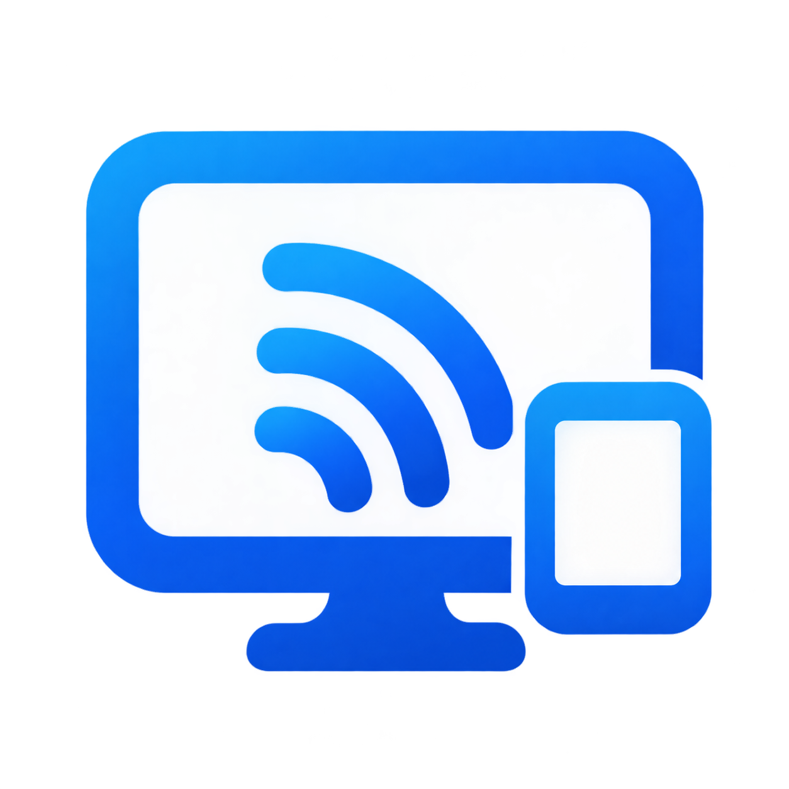

<div align="center">
  
  <h1>MGRScreen</h1>
  <p><strong>Compartilhamento de tela e áudio no Windows, com visualizador para Android</strong></p>
  <p>Desenvolvido por <a href="https://github.com/YanGDBr">YanGDBr</a> · Em desenvolvimento</p>
  <p>
    <a href="https://github.com/YanGDBr/MGRScreen/releases/tag/v1.0.0"></a>
    <a href="https://github.com/YanGDBr/MGRScreen/stargazers"></a>
    <a href="LICENSE"></a>
  </p>
</div>

---

## Instalação e uso

Baixe o pacote **Windows x64** ou o **APK para Android 10+** na [release v1.0.0](https://github.com/YanGDBr/MGRScreen/releases/tag/v1.0.0).

- **Windows** — instale o [FFmpeg Essentials](https://www.gyan.dev/ffmpeg/builds/) com `winget install --id Gyan.FFmpeg.Essentials -e`. Extraia o ZIP inteiro, abra `MGRScreen.exe` e crie ou entre em uma sala. Participantes no Windows podem transmitir tela, áudio e câmera.
- **Android** — instale o APK, informe um apelido e escolha uma sala para assistir. O player tem tela cheia, orientação e controles de volume.

Use a mesma rede local ou conecte os dispositivos ao Tailscale. As salas aparecem na busca automática e também podem ser abertas pelo IP ou nome do anfitrião. [Guia do Android](docs/ANDROID_VIEWER.md)

## Desenvolvimento

O Windows usa C# e WPF sobre .NET 8, com Windows Graphics Capture, WASAPI e FFmpeg como processo externo. O Android usa Kotlin, Jetpack Compose e MediaCodec.

Com o .NET 8 SDK e o FFmpeg no PATH, rode no Windows:

```powershell
dotnet build MGRScreen.sln
dotnet run --project src/MGRScreen.App
```

Para o Android, instale o JDK 17 e o Android SDK 35. Configure `ANDROID_HOME` ou abra a pasta `android/` no Android Studio.

```powershell
cd android
.\gradlew.bat assembleDebug testDebugUnitTest
```

O código Windows está em `src/`, o visualizador em `android/` e o teste de integração em `tests/`. [Arquitetura](docs/ARCHITECTURE.md) · [Protocolo de rede](docs/PROTOCOL_V2.md)

O código do MGRScreen é licenciado sob MIT. Consulte os [avisos de terceiros](THIRD_PARTY_NOTICES.md) para as dependências distribuídas.
